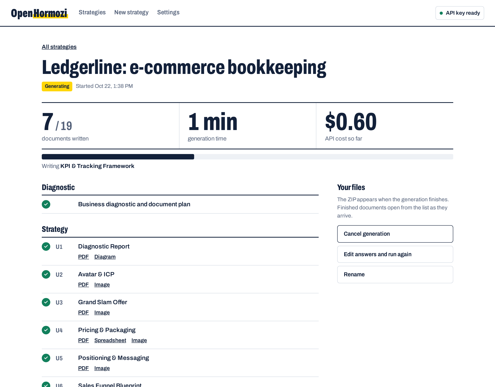
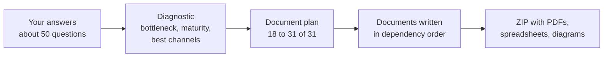
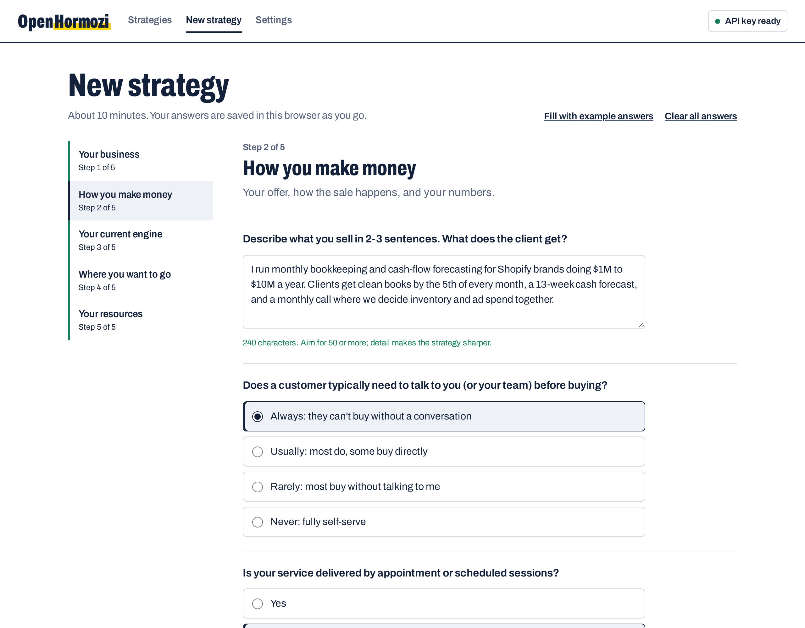
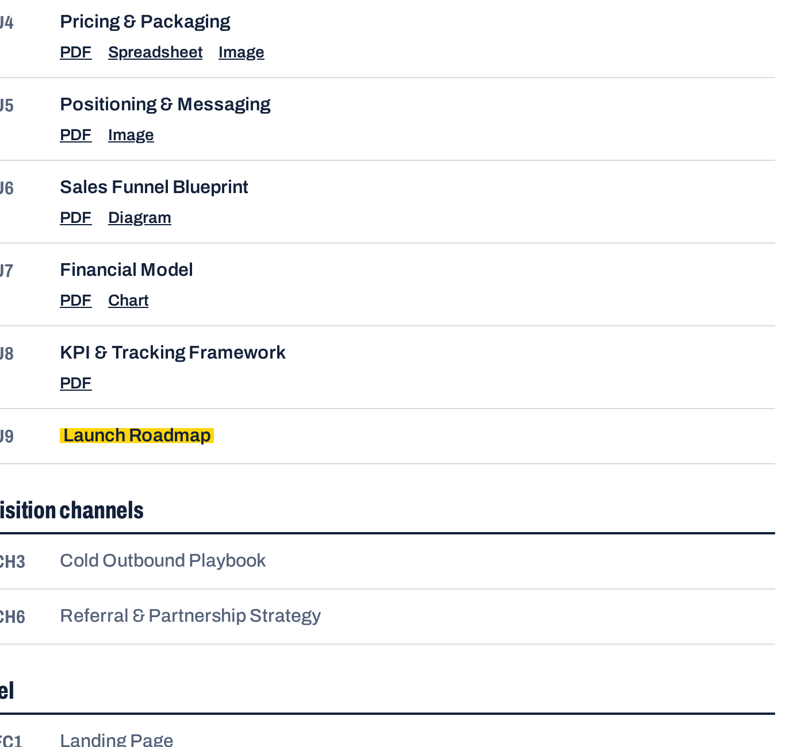

<h1 align="center">OpenHormozi</h1>

<p align="center">
  <b>The open-source alternative to ACQ AI, Alex Hormozi's AI business advisor.</b><br>
  Fill in one form about your business. Get a complete acquisition strategy built on Hormozi's frameworks:<br>
  offer, pricing, funnel, sales scripts, channel playbooks and a week-by-week launch roadmap.<br>
  Runs on your computer with your own Anthropic API key.
</p>

<p align="center">
  <a href="#run-it-on-your-computer">Install</a> ·
  <a href="#31-documents-picked-for-your-business">What you get</a> ·
  <a href="#what-will-this-cost-me">Cost</a> ·
  <a href="#when-something-goes-wrong">Troubleshooting</a>
</p>

<p align="center">
  
</p>

> **Not affiliated with Alex Hormozi or Acquisition.com.** OpenHormozi is an independent,
> MIT-licensed project. It is not endorsed by, sponsored by or connected to Alex Hormozi,
> Acquisition.com or ACQ AI. His name appears here only to describe the publicly
> published frameworks the prompts apply ($100M Offers, $100M Leads).

## Why this exists

[ACQ AI](https://ai.acquisition.com/) is a hosted chat assistant you sign into and ask questions.
OpenHormozi works the way a consultant's intake does: you answer about 50 questions once,
it diagnoses the business, decides which documents you need, and writes them all.
You get a folder of PDFs, spreadsheets, diagrams and ready-to-edit pages, generated on your own machine,
with code you can read and change.

## How a strategy gets made



1. **Diagnostic.** Rules derived from the form plus a deep reasoning pass with Claude Opus find your
   real bottleneck (visibility, lead flow, conversion, pricing, retention or positioning), your
   maturity stage, and the acquisition channels that fit your budget, time and hard limits.
2. **Plan.** Only the documents your business needs are triggered. A local bakery and a B2B
   consultant get different playbooks.
3. **Writing.** Each document is written with the summaries of the documents before it, so the
   offer in the pricing doc matches the offer doc, and the landing page uses your positioning.
4. **Delivery.** Branded PDFs, Excel models, diagrams and HTML pages land in one ZIP, sorted into
   folders, with a `0_START_HERE.pdf` that tells you what to open first.

## 31 documents, picked for your business

The nine strategy documents are always written. The rest depend on your business model, channels and stage.

| Group | Documents |
|---|---|
| **Strategy** (always) | Diagnostic Report · Avatar & ICP (+ persona card) · Grand Slam Offer (+ Value Equation) · Pricing & Packaging (+ pricing calculator .xlsx) · Positioning & Messaging (+ positioning map) · Sales Funnel Blueprint (+ diagram) · Financial Model (+ chart) · KPI & Tracking Framework · Launch Roadmap (+ visual timeline) |
| **Acquisition channels** | Google Ads (+ keyword master .xlsx) · Social Ads · Cold Outbound · Organic Content · Local SEO & Maps · Referral & Partnerships · Marketplace |
| **Funnel** | Landing Page (+ editable HTML page) · Lead Magnet (+ PDF) · Webinar / VSL Script · Email Sequences (+ HTML preview) · Retargeting |
| **Sales and operations** | Sales Playbook · Booking & Scheduling Flow · Local Visibility Baseline · On-Site Experience & Upsell · Retention, Loyalty & Referral · Client Operations · Online Purchase Optimization |
| **Proof and tools** | Proof & Credibility Kit · Proof Generation Plan · Automation & Tech Stack Guide |

Every document is written for the business in the form: your numbers, your customers' words,
your constraints. Generic advice is filtered out by the prompts.

## Run it on your computer

You need an **Anthropic API key**. Create one in the [Anthropic Console](https://console.anthropic.com/settings/keys)
and add a few dollars of credit. Nothing else to install by hand.

**1. Download the project.** Click **Code → Download ZIP** above and unzip it, or:

```bash
git clone https://github.com/SolvAI/open-hormozi.git
```

**2. Start it.**

| System | Do this |
|---|---|
| **Windows** | Double-click `start.bat` |
| **macOS** | Double-click `start.command`. The first time, macOS may block it: right-click the file, choose **Open**, then **Open** again. |
| **Linux** | Run `./start.sh` in a terminal |

The first launch takes a few minutes. The script installs [uv](https://docs.astral.sh/uv/),
which downloads its own Python 3.12, the dependencies, and the Chromium engine used to render
PDFs (about 250 MB in total). Later launches start in seconds.

**3. Use it.** Your browser opens at `http://localhost:8765`.
Paste your API key in **Settings**, click **Test key**, then **New strategy**.
Keep the terminal window open while a strategy generates.

<p align="center">
  
</p>

## What will this cost me?

The software is free. Generation uses your Anthropic API credit:

| | Default models |
|---|---|
| Cost per strategy | about **$5 to $8** |
| Time per strategy | about **40 minutes**, in the background |
| Documents | 18 to 31, depending on the business |

The cost shows live on the strategy page. You can change the model used for each role in
**Settings**: Opus 5.5 for the diagnostic and the hardest documents, Sonnet 5.5 for most
writing, Haiku 5.5 for the summaries passed between documents.

## Your data stays on your machine

- Your answers, API key and documents live in the `data/` folder next to the code.
  The key is stored in `data/settings.json` and sent only to Anthropic's API.
- The app listens on `localhost` only, and refuses requests from other websites.
- Rendering the PDFs loads web fonts from Google Fonts and the chart and diagram libraries
  from jsDelivr. No analytics, no telemetry, no account.

## Manage your strategies



- Watch each document get written, open finished PDFs before the run ends.
- Strategies run one at a time; start several and they queue.
- **Cancel** a run at any point. **Resume** later and only the missing documents are generated.
- **Edit answers and run again** to compare versions of your strategy.
- Download everything as one ZIP.

<br clear="right">

## When something goes wrong

Errors show up as notifications with a button that fixes them.

| You see | What to do |
|---|---|
| *Your Anthropic credit balance is empty* | Add credits in the [Console billing page](https://console.anthropic.com/settings/billing), then click **Resume**. Finished documents are kept. |
| *Anthropic rejected your API key* | Paste a valid key in **Settings** and use **Test key**. |
| *You reached your Anthropic spend limit* | Raise it in the [Console limits page](https://console.anthropic.com/settings/limits), then **Resume**. |
| *Rate limit* or *overloaded* | Wait a few minutes, then **Resume**. |
| *The app closed during a generation* | **Resume**. It continues where it stopped. |

Other cases:

- **Linux: Chromium won't start.** Install its system libraries once:
  `sudo .venv/bin/python -m playwright install-deps chromium`
- **Port 8765 is taken.** The app picks the next free port and prints the address.
- **Windows: "Windows protected your PC".** Click **More info**, then **Run anyway**.
- **macOS: `start.command` does nothing.** Open Terminal in the folder and run `bash start.command`.
- Each strategy has a **Run log** at the bottom of its page with every step.

## Other ways to run it

<details>
<summary><b>With pip and your own Python (3.10+)</b></summary>

```bash
python -m venv .venv
source .venv/bin/activate          # Windows: .venv\Scripts\activate
pip install -r requirements.txt
python -m playwright install chromium
python -m app
```
</details>

<details>
<summary><b>With Docker</b></summary>

```bash
docker compose up --build
```

Then open `http://localhost:8765`. Data is kept in `./data`.
</details>

<details>
<summary><b>From the command line, without the web app</b></summary>

```bash
export ANTHROPIC_API_KEY=sk-ant-...    # or save the key in the app's Settings
uv run python cli.py examples/example_form.json
```

Output goes to `output/`. The form is a JSON object of answers keyed `Q1` to `Q49`;
`examples/example_form.json` is a complete, fictional example and `engine/form/schema.py`
lists every question and its allowed answers.
</details>

## Configuration

- **Settings page:** API key and the model for each role.
- **`config.yaml`:** reasoning effort, output token limits and retry policy per tier.
- **Environment:** `ANTHROPIC_API_KEY`, `OPENHORMOZI_PORT`, `OPENHORMOZI_HOST`,
  `OPENHORMOZI_DATA_DIR`. A `.env` file in the project folder is read at startup.

## Project layout

```
app/          local web app: API, job queue, UI (plain HTML, CSS and JS, no build step)
engine/       the strategy pipeline
  form/         the 49 questions and their validation
  pipeline/     diagnostic, document planning and orchestration
  specs/        one file per document: purpose, sections, formats, quality rules
  prompts/      Hormozi principles and prompt assembly
  processors/   PDF, Excel, PNG, chart and diagram rendering
templates/    brand stylesheet, HTML and Excel templates
examples/     a fictional example form
tests/        offline rendering test (no API calls)
```

Run the offline test with `uv run python -m tests.test_processors_offline`. It renders every
format of every document from sample content.

## Contributing

Issues and pull requests are welcome. Good first areas: new document specs in `engine/specs/`,
better templates in `templates/`, more languages for the deliverables (`engine/prompts/language.py`),
and support for other LLM providers in `engine/llm/`.

## License and credits

[MIT](LICENSE). The bundled [Archivo](https://github.com/Omnibus-Type/Archivo) typeface is under the
SIL Open Font License (`app/static/fonts/OFL.txt`).

Built on the business frameworks Alex Hormozi has published in *$100M Offers* and *$100M Leads*.
If this project helps you, buy the books.
